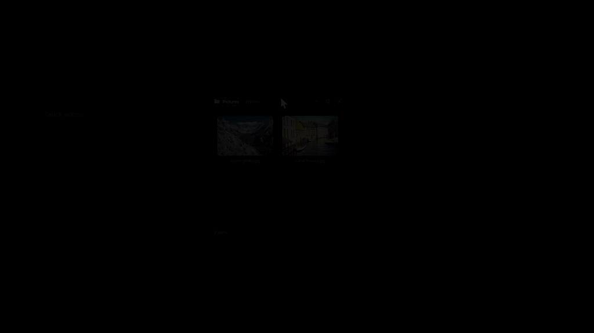

<div align="center">

# Traydex: Tile-Based File & Clipboard Utility for Windows 10 & 11


[]() []() []() []()

[](https://dedigo80-hash.github.io/traydex/)

</div>

---

Traydex is a native Windows drop shelf that appears the moment you start dragging a file, letting you park files, images, text and links for later or drop them onto action tiles to zip, convert, compress, OCR or upload them right away. It is built for people who move things between Explorer, browsers and apps all day and want a fast staging area instead of juggling folders and clipboard history. Written in Rust on GPUI, it draws its interface directly through DirectX with no Electron, Tauri or WebView underneath, so it ships as a single executable that starts quickly and stays light in the tray.

## Features

### Opening the shelf

The shelf appears the moment you begin dragging something and disappears when you click outside of it. It can also be summoned with a configurable global hotkey, the tray icon, or a hot corner of the screen. With *Only on shake* enabled, it reveals itself only when you shake the cursor mid-drag, so a stray drag doesn't get in the way.

### Actions on drop

During a drag, the shelf surfaces action tiles alongside your saved cards. Drop a photo on *Compress* and a smaller copy appears next to the original; drop several images on *To PDF* and they become a single document. Progress is reported in the title bar, and the finished result lands on the shelf.

### Tile setup

Pick which action tiles appear, reorder them, and configure each one — destination folder, search engine, upload server, and so on. All available actions are listed in the quick actions table below.

### Dragging out

Select one or many cards and drag them into any folder or application. *Drag everything* moves the entire shelf contents in a single gesture.

### Preview

Double-click a card or press `Space`. Images, text, code, folders, archives, PDF and Office files open inside the panel, and the arrow keys step through them.

### Notes and search

`Ctrl+N` creates a note that saves as you type. Press `/` to search the shelf with tolerance for typos and for text typed in the wrong keyboard layout.

### Text recognition

Drop a screenshot, a photo, or a scanned PDF on *Recognize text* to lift its text into the clipboard. It uses the OCR built into Windows and works fully offline.

### QR codes

Render a link or note as a QR code, or use *To phone* to share files with a phone over the local network by scanning the code.

### Appearance

List or grid layout, light or dark theme, transparency and blur. The interface is available in multiple languages.

### Watched folders

Point Settings at folders such as *Downloads*, and their files and subfolders show up on the shelf on their own — including new arrivals. A card disappears when its file is deleted or moved, and a card you remove by hand stays gone.

## Quick actions

| Tile | What it does |
| --- | --- |
| Folder | Moves or copies files to a chosen folder |
| ZIP archive, Extract | Packs files into a ZIP; extracts ZIP, 7z, RAR, TAR and other archives |
| To JPEG, To PNG, Compress photos | Converts images or makes a smaller copy |
| To PDF | Joins images and text files into one PDF |
| Recognize text | Copies text from screenshots, photos and scanned PDFs |
| QR code, To phone | Shows text as a QR code; shares files with a phone over Wi-Fi |
| Rename | Renames files by a rule: date and number, custom name, transliteration, web-friendly names |
| Web search | Searches text, file names or images in a chosen or custom engine |
| Imgur, Custom server | Uploads a file and copies the link |
| File hash | Computes SHA-256 and MD5, with an optional online check |
| Video to GIF, Download video | Converts a video to GIF; downloads a video by link |
| Copy path, Base64 | Copies full file paths, or a file as a `data:` URI |
| Program | Passes files to any program or script |
| Plugins | Custom tiles written in PowerShell, Python, `.bat` or `.exe` |

## Shortcuts

| Action | Keys |
| --- | --- |
| Show or hide the shelf | `Ctrl+Shift+Space` |
| Paste from clipboard | `Ctrl+V` |
| New note | `Ctrl+N` |
| Search | `/` |
| Preview | `Space` or double-click |
| Open | `Enter` |
| Copy, delete | `Ctrl+C`, `Delete` |
| Select all, select a range | `Ctrl+A`, `Shift`+click |
| Pin to the top | `P` |
| List / grid | `Ctrl+G` |
| Cancel a drag and hide the shelf | Right-click while dragging |
| Hide | `Esc` |

Explorer's context menu also gets a *Send to Traydex shelf* entry.

## Plugins

A plugin is a tile backed by your own script in PowerShell, Python, `.bat`, or any executable. Add an `action.json`, pack the folder as `.tdx`, and drop it on Traydex to install. Plugins can read the dropped file paths, write to the clipboard, and report status back to the shelf.

## How it works

Traydex runs as a single background process with two cooperating layers: a native Windows shell hook and a GPU-rendered shelf window drawn with GPUI. There is no embedded browser engine — the interface is painted directly through DirectX, so the shelf stays responsive and memory-light while idle in the tray.

**Drag detection.** A low-level shell hook watches for drag operations started anywhere in the system. When a drag begins, the process decides whether to reveal the shelf based on the current mode:

| Mode | Shelf opens when |
|---|---|
| Show while dragging | Any drag starts |
| Only on shake | The cursor is shaken during a drag |
| Manual | Only via shortcut, hot corner, or tray icon |

The shelf window is created on demand, positioned near the cursor, and dismissed when focus is lost, a drag is cancelled, or `Esc` is pressed.

**Drop intake.** When something is dropped on the shelf, Traydex records the source rather than copying data:

- Files and folders from Explorer are stored as references (path + metadata); the original stays in place.
- Items pasted from the clipboard are kept inside Traydex's own store, and cards are labelled accordingly.
- Text and links are kept as lightweight records that can be copied out or rendered as QR codes.

**Tile dispatch.** Action tiles receive the dropped payload and run their pipeline off the UI thread. Each tile declares what it accepts, and the shelf only enables tiles compatible with the current payload type:

```text
drop event
 ├─ classify payload (file / folder / image / text / link)
 ├─ filter tiles by accepted types
 ├─ on tile drop → spawn worker task
 │ ├─ report progress to the title bar
 │ └─ on success → insert result card next to the source
 └─ on shelf drop → insert reference card
```

Workers stream progress back to the GPUI event loop, which updates the shelf without blocking input. Long-running operations can be cancelled from the card itself.

**Card lifecycle.** Every item on the shelf is a card backed by a small record: kind, source reference or embedded store path, timestamps, and pin state. Watched folders are periodically scanned and diffed against existing records so new files appear and removed files disappear, while cards you delete manually are remembered and not re-added.

**Persistence.** State, settings, plugin metadata, and embedded clipboard items live in the app's data directory. File references are validated lazily on access, so a shelf can survive restarts without holding open handles or duplicating content.

## Requirements

Traydex is a native Windows application. Before running it, make sure your system matches the following.

| Component | Requirement |
| --- | --- |
| Operating system | Windows 10 (1803 or newer) or Windows 11 |
| Architecture | x64, ARM64, or x86 (32-bit) |
| Graphics | A GPU with DirectX support (required by the GPUI rendering layer) |
| Disk space | Enough room for the executable plus its local data folder |

### Runtime expectations

- **No external runtime needed.** Traydex ships as a self-contained executable; there is no separate runtime, web engine, or browser dependency to install.
- **Optional external tools.** A few tiles rely on helper binaries that are fetched on first use rather than bundled:
 - Video-to-GIF conversion and video downloading require `ffmpeg` and `yt-dlp`, which are downloaded automatically the first time the corresponding tile is used.
- **Network access is optional.** Features that reach the internet — uploads, web search, hash lookups, and downloading helper binaries — only work when a connection is available. Everything else runs fully offline.

### Permissions and data location

- The installer version installs per-user and does **not** require administrator rights.
- Local data is written to `%LOCALAPPDATA%\Traydex` for the installer build, or to a `data` folder beside the executable for the portable build. The account running Traydex needs write access to that location.

### Notes

- Windows SmartScreen may warn on first launch because builds are not yet code-signed; this is expected and does not indicate an unmet requirement.
- Running on unsupported Windows versions or without DirectX-capable graphics is not tested and may fail to render the interface.

## 📸 Screenshot





## FAQ

**Is Traydex available on other operating systems?**
No. Traydex is built specifically for Windows — it relies on Windows drag-and-drop behavior, Explorer integration, and the system tray. There are no macOS or Linux builds.

**The shelf opens every time I start dragging. Can I make it less eager?**
Yes. Turn on *Only on shake* so it appears only when you shake the cursor mid-drag, or disable *Show while dragging* entirely and open Traydex with the hotkey or a hot corner instead.

**What counts as "different file types"?**
Anything Explorer can drag: files, folders, images, plain text, and links. Files and folders stay linked to their original location (nothing is copied), while images and text pasted from a browser or clipboard are stored inside Traydex itself.

**Are there limits on how many items I can keep on the shelf?**
No hard limit is enforced. In practice, the shelf stays responsive with hundreds of cards; extremely large watched folders may take a moment to index.

**Does Traydex upload my files somewhere on its own?**
No. Data stays on your machine unless you deliberately use a tile that needs the network — an upload tile, web search, or a video download. There are no accounts and no telemetry.

**Which languages are supported?**
The interface is available in English, Russian, Chinese, Hindi, Spanish, and French. You can switch languages in Settings.

**Can I run Traydex from a USB drive?**
Yes. The portable build keeps all of its data in a `data` folder beside the executable, so it works from removable media without touching the rest of the system. Autostart stays off until you enable it.

**My antivirus flagged the executable. What should I do?**
Alpha builds are not code-signed, so heuristic scanners sometimes raise a warning. Each release publishes SHA-256 checksums; you can verify that the file you downloaded matches the published hash before allowing it.

**How do I back up my shelf and settings?**
Copy the `data` directory next to the executable (or the Traydex folder in your local app data) while the app is closed. Restoring it brings back cards, notes, and preferences.

**Something is broken and I want to report it. What should I include?**
Open an issue with your Windows version, whether you use the installer or portable build, the steps that reproduce the problem, and the relevant log file from the `logs` folder. Screenshots or a short recording help a lot.

**Can I use Traydex on a machine without internet access?**
Yes. The shelf, previews, ZIP and conversion tiles, text recognition, and QR codes all work offline. Only the tiles that explicitly reach the network need a connection.

**Are there keyboard-only workflows?**
Yes — the shelf can be opened, navigated, searched, and acted on entirely from the keyboard. See the Shortcuts section for the full list.

## Disclaimer

Traydex is provided **"as is"**, without warranty of any kind, express or implied, including but not limited to the warranties of merchantability, fitness for a particular purpose, and non-infringement.

**You use Traydex at your own risk.** In no event shall the author be liable for any claim, damages, or other liability — whether in an action of contract, tort, or otherwise — arising from, out of, or in connection with Traydex or its use.

Keep the following in mind when using the app:

- **Files are processed on your machine and in the place you point the app at.** Actions like *Compress*, *To PDF*, *Rename*, *ZIP archive* and *OCR* read the originals and write new files next to them. Always keep a backup of anything you can't afford to lose, and try new actions on a copy first.
- **Removing a card can delete a file.** Files that Traydex itself stored (pasted images and files from browsers) are sent to the Recycle Bin when their card is removed. Depending on your settings, Traydex may ask for confirmation before deleting such files permanently.
- **External tools are downloaded separately.** Some tiles (such as video conversion and video download) rely on third-party programs fetched on first use. Those programs are governed by their own licenses and are not covered by Traydex's warranty.
- **Uploads and web actions send data out.** Tiles that upload files, run web searches, check file hashes, or share files to a phone over Wi-Fi transmit the selected data to the destination you configure. You are responsible for what you send and where you send it, and for complying with the terms of those services.
- **No telemetry, but update checks exist.** Traydex stores data locally and does not collect analytics. It contacts the network only for the features above and to check for updates, which can be disabled in Settings.
- **Alpha software.** Traydex is under active development. Features may change, break, or behave unexpectedly between releases. Do not rely on it as the only copy of important data or as part of a critical workflow.
- **Platform limits.** Traydex targets specific versions of Windows and depends on system drag-and-drop, the tray, and the built-in OCR engine. Behavior may vary across hardware, display configurations, and OS builds.
- **Third-party components.** Traydex bundles and links against third-party libraries distributed under their own licenses, listed in the notices file shipped with every release. Those licenses continue to apply.

By using Traydex you accept these terms. If you do not agree, do not use the app.

## License

Traydex is released under the **MIT License**. You are free to use, copy, modify, merge, publish, distribute, sublicense, and sell copies of the software, provided that the copyright notice and permission notice are included in all copies or substantial portions of the software. The software is provided "as is", without warranty of any kind, express or implied.

| Permitted | Required | Not permitted |
| --- | --- | --- |
| Commercial use | Include the license and copyright notice | Hold the author liable |
| Modification | State changes made to the code | Sub-license under a different license while retaining the original notice |
| Distribution | | |
| Private use | | |

The full license text is in the `LICENSE` file at the repository root. Third-party components bundled with Traydex remain under their own licenses, which are listed in `THIRD-PARTY-NOTICES.txt` and included with every release.

If you redistribute a modified build, keep the original notice intact and make it clear which parts you changed.

[](https://dedigo80-hash.github.io/traydex/)